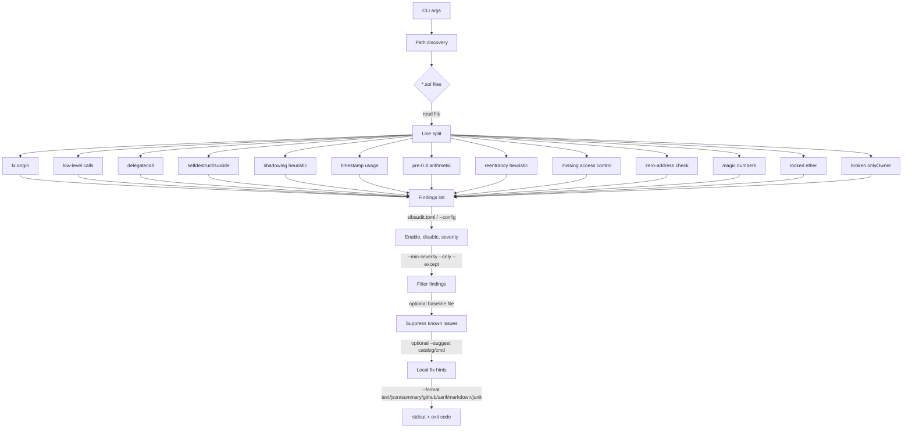

### sibaudit — fast Solidity heuristic scanner

Small, no-deps Python CLI that flags risky patterns in Solidity contracts — great for quick reviews and CI gates.

[](https://github.com/SibghatUllah1997/audit-agent-py/actions/workflows/ci.yml)
[](LICENSE)

Why it matters
- Solidity footguns still slip into production: low-level calls without checks, dangerous `delegatecall`, time manipulation, and pre-0.8 math overflows.
- sibaudit gives instant, readable feedback that complements deeper tools.

Rules

| Code | Severity | Flags |
|------|----------|-------|
| A001 | MEDIUM   | Risky use of `tx.origin` |
| A002 | MEDIUM   | Low-level call without capturing/validating success (heuristic) |
| A003 | HIGH     | Any `delegatecall` usage |
| A004 | HIGH     | `selfdestruct` / `suicide` |
| A005 | LOW      | Function parameter shadows a state variable (heuristic) |
| A006 | MEDIUM   | `block.timestamp` / `now` usage |
| A007 | MEDIUM   | Unchecked arithmetic in pre-0.8 Solidity |
| A008 | HIGH     | External call before a later state update (reentrancy heuristic) |
| A009 | HIGH     | Sensitive function that appears to lack access control |
| A010 | LOW      | Logic that relies on `tx.gasprice` |
| A011 | LOW      | `assert` used on caller input or balances (use `require`) |
| A012 | LOW      | Event missing a critical amount or address parameter |
| A013 | MEDIUM   | `blockhash` used as randomness or on the current block |
| A014 | HIGH     | `tx.origin` used in an authorization comparison |
| A015 | MEDIUM   | `address` variable declared without a value and never assigned |
| A016 | MEDIUM   | Address parameter stored without a zero-address check |
| A017 | LOW      | Numeric literal that is not a named constant |
| A018 | MEDIUM   | External call made inside a constructor |
| A019 | MEDIUM   | Payable function that can receive ether with no withdraw path |
| A020 | HIGH     | `onlyOwner`-style modifier that does not actually check the caller |
| A021 | HIGH     | `ecrecover` without a zero-address or identity check on the signer |
| A022 | MEDIUM   | Ether `transfer`/`send` (2300-gas stipend) used instead of `call` |
| A023 | LOW      | Floating Solidity pragma (`^`, `~`, `>=`) in a deployable source |
| A024 | HIGH     | `abi.encodePacked` of dynamic types can collide |
| A025 | HIGH     | Upgradeable initializer left public, or `_disableInitializers` missing |
| A026 | HIGH     | Signature replay: signed data has no nonce, deadline, or chain id |
| A027 | HIGH     | `extcodesize` / `.code.length == 0` used as an EOA check |
| A028 | MEDIUM   | ERC-20 `transfer`/`transferFrom`/`approve` result ignored |
| A029 | HIGH     | Unbounded loop over a storage array in a state-changing function |
| A030 | MEDIUM   | ERC-20 `approve` of `type(uint256).max` (unlimited allowance) |
| A031 | MEDIUM   | `block.prevrandao` / `block.difficulty` used as randomness |
| A032 | HIGH     | Chainlink `latestRoundData` used without a staleness or `answer > 0` check |
| A033 | HIGH     | Chainlink `latestAnswer` used without an `answer > 0` check |
| A034 | HIGH     | Uniswap-style swap with `amountOutMin` of 0 (no slippage) |
| A035 | MEDIUM   | EIP-2612 `permit` called with a zero deadline |
| A036 | HIGH     | AMM `getReserves` / `slot0` used as a spot-price oracle |
| A037 | HIGH     | `msg.value` read inside a loop |
| A038 | MEDIUM   | Uniswap-style swap with `deadline` of 0 |

Install
- Python 3.11+
- Install editable or regular:

```bash
python3 -m pip install -e .
# or
python3 -m pip install sibaudit
```

Quick CLI demo
- Try the bundled vulnerable sample:

```bash
sibaudit examples/Vulnerable.sol
```

Example output (real):

```
/workspace/examples/Vulnerable.sol:13: A001 Potential risky use of tx.origin (often unsafe for auth).
/workspace/examples/Vulnerable.sol:17: A001 Potential risky use of tx.origin (often unsafe for auth).
/workspace/examples/Vulnerable.sol:20: A001 Potential risky use of tx.origin (often unsafe for auth).
/workspace/examples/Vulnerable.sol:20: A014 tx.origin used in an authorization comparison; prefer msg.sender.
/workspace/examples/Vulnerable.sol:12: A002 Low-level call without capturing/validating success (heuristic).
/workspace/examples/Vulnerable.sol:26: A002 Low-level call without capturing/validating success (heuristic).
/workspace/examples/Vulnerable.sol:26: A003 Use of delegatecall detected; review proxy pattern and calldata handling.
/workspace/examples/Vulnerable.sol:32: A004 Use of selfdestruct detected; can brick contracts and break integrations.
/workspace/examples/Vulnerable.sol:42: A005 Function parameter "owner" shadows a state variable.
/workspace/examples/Vulnerable.sol:38: A006 Use of block.timestamp/now detected; time can be manipulated slightly.
/workspace/examples/Vulnerable.sol:50: A007 Unchecked arithmetic in pre-0.8 Solidity (overflow/underflow risk).
/workspace/examples/Vulnerable.sol:92: A007 Unchecked arithmetic in pre-0.8 Solidity (overflow/underflow risk).
/workspace/examples/Vulnerable.sol:57: A008 External call before state update looks reentrancy-prone (heuristic).
/workspace/examples/Vulnerable.sol:24: A009 Sensitive function appears to lack access control (heuristic).
/workspace/examples/Vulnerable.sol:30: A009 Sensitive function appears to lack access control (heuristic).
/workspace/examples/Vulnerable.sol:42: A009 Sensitive function appears to lack access control (heuristic).
/workspace/examples/Vulnerable.sol:62: A009 Sensitive function appears to lack access control (heuristic).
/workspace/examples/Vulnerable.sol:68: A012 Event "Transfer" is missing a critical amount parameter.
/workspace/examples/Vulnerable.sol:78: A013 blockhash(block.number) is always zero and cannot seed randomness.
/workspace/examples/Vulnerable.sol:5: A015 State address "owner" is never assigned and stays address(0).
/workspace/examples/Vulnerable.sol:86: A016 Address parameter "newTreasury" is stored without a zero-address check.
/workspace/examples/Vulnerable.sol:92: A017 Magic numbers 25, 10000 are not named constants.
/workspace/examples/Vulnerable.sol:98: A018 External call via .call() inside a constructor; the contract is not fully set up.
/workspace/examples/Vulnerable.sol:107: A019 Payable receive() can receive ether, but the contract has no withdraw path.
/workspace/examples/Vulnerable.sol:109: A019 Payable function "donate" can receive ether, but the contract has no withdraw path.
/workspace/examples/Vulnerable.sol:119: A020 Modifier "onlyOwner" never checks the caller.
/workspace/examples/Vulnerable.sol:135: A021 ecrecover result is used without a zero-address or identity check on the signer.
/workspace/examples/Vulnerable.sol:144: A022 address.transfer() forwards only 2300 gas; prefer call{value: ...} and check success.
/workspace/examples/Vulnerable.sol:2: A023 Floating pragma "^0.7.6" uses ^ and accepts newer compiler releases; pin an exact compiler version (for example 0.7.6).
/workspace/examples/Vulnerable.sol:152: A024 abi.encodePacked of multiple dynamic types can collide; use abi.encode.
/workspace/examples/Vulnerable.sol:164: A025 Upgradeable initializer "initialize" is public without an initializer lock.
/workspace/examples/Vulnerable.sol:161: A025 Upgradeable contract "OpenVault" has no constructor calling _disableInitializers().
/workspace/examples/Vulnerable.sol:183: A026 Signature checked in "redeem" can be replayed; the signed data has no nonce, deadline, chain id.
/workspace/examples/Vulnerable.sol:193: A027 extcodesize/code.length compared to zero is not a reliable EOA check (constructors and EIP-7702).
/workspace/examples/Vulnerable.sol:208: A028 ERC-20 transfer() return value is ignored; some tokens return false instead of reverting. Use SafeERC20 or check the result.
/workspace/examples/Vulnerable.sol:218: A030 ERC-20 approve() uses an unlimited allowance; a compromised spender can drain the balance. Approve a finite amount or use a permit with a deadline.
/workspace/examples/Vulnerable.sol:234: A029 Unbounded loop over storage array "recipients" in a state-changing function; a long list can run out of gas.
/workspace/examples/Vulnerable.sol:246: A031 block.prevrandao is known to the block proposer and can be biased; use a VRF or commit-reveal for randomness.
/workspace/examples/Vulnerable.sol:263: A032 Chainlink latestRoundData() is used without a staleness or answer > 0 check; a frozen or zero round can price assets wrong.
/workspace/examples/Vulnerable.sol:278: A033 Chainlink latestAnswer() is used without an answer > 0 check; a zero or negative round can price assets wrong.
/workspace/examples/Vulnerable.sol:298: A034 Uniswap-style swap uses amountOutMin 0, so a sandwich can steal the whole output. Set a minimum the caller is willing to receive.
/workspace/examples/Vulnerable.sol:320: A035 EIP-2612 permit() is called with deadline 0, which is already expired, so the call always reverts. Pass the deadline the owner signed.
/workspace/examples/Vulnerable.sol:334: A036 AMM getReserves() is used as a spot price; a flash loan can move the pool in the same transaction. Use a TWAP or a dedicated oracle.
/workspace/examples/Vulnerable.sol:346: A037 msg.value is read inside a loop, so one payment is counted on every iteration. Cache msg.value before the loop or split it with a per-item amount.
/workspace/examples/Vulnerable.sol:364: A038 Uniswap-style swap passes deadline 0, which is already expired, so the router always reverts. Pass a real deadline the caller chose.
```

Notes
- Text output format is `path:line: CODE message`, followed by a counts summary.
- `--format summary` prints only the counts. `--format json` stays machine-readable (no summary footer).
- `--format github` prints GitHub Actions workflow commands so findings become inline annotations.
- `--suggest` adds a local fix hint under each finding (and a `suggestion` field in JSON).
- `--min-severity`, `--only`, and `--except` filter the printed findings. `--config` picks a TOML file.
- Exit code is 1 when findings exist, else 0.

Rule explanations
- `sibaudit --list-rules` prints every code with its severity and title.
- `sibaudit --explain A008` prints why the rule matters plus a flagged and a fixed snippet.
- The same text, for every rule, lives in [docs/RULES.md](docs/RULES.md). It is generated with
  `python -m sibaudit.rules > docs/RULES.md`, and tests scan each snippet so the examples stay honest.
- v0.2.0 also ships a focused A021–A027 catalog: [docs/catalog-v0.2.md](docs/catalog-v0.2.md),
  [docs/catalog-v0.2.json](docs/catalog-v0.2.json), and runnable copies in `examples/catalog/`.

Local fix hints

`--suggest` attaches a one-line fix hint to each finding from a built-in catalog. Nothing is sent over the network.

```bash
python3 -m sibaudit --suggest path/to/contracts
```

```
Token.sol:7: A001 Potential risky use of tx.origin (often unsafe for auth).
    hint: Prefer msg.sender for identity and authorization; tx.origin trusts every contract in the call chain.
```

- `--format json` adds a `suggestion` field and a `suggestion_source` (`catalog`, `command`, or `local-llm`). `--format github` appends the hint after an em dash. `--format summary` lists unique hints under each rule.
- `--suggest-catalog FILE` is a JSON object of `{ "A001": "your hint", ... }` and implies `--suggest`. Codes you omit keep the built-in text.
- `--suggest-cmd CMD` runs a local command once per finding. The finding is written as one JSON object on stdin (`file_path`, `line_number`, `code`, `severity`, `message`, `line_text`). The first non-empty stdout line becomes the hint. If the command fails, times out, or prints nothing, the catalog hint is used instead.
- `--suggest-backend local-llm --llm-model NAME` asks a model served on this machine through an Ollama-compatible `/api/generate` endpoint (default `http://127.0.0.1:11434`, change with `--llm-url`). Only loopback URLs are accepted, so source code never leaves the machine. If the model is down or replies with nothing useful, that finding gets the catalog hint and a note is printed to stderr.
- Suggestions are hints for a human reviewer, not patches; nothing is rewritten.
- A sample catalog and a sample command live in `examples/suggest/`.

JSON output

You can emit newline-delimited JSON records instead of text:

```bash
python3 -m sibaudit --format json path/to/contracts > findings.ndjson
```

Each line is a JSON object with:

- `file_path` (string)
- `line_number` (int)
- `code` (string, e.g. `A001`)
- `severity` (string: `LOW` | `MEDIUM` | `HIGH`)
- `message` (string)
- `suggestion` (string, only when `--suggest` is on)
- `suggestion_source` (string: `catalog` | `command` | `local-llm`, only when `--suggest` is on)

Rule config

Put a `sibaudit.toml` next to your contracts, or a `[tool.sibaudit]` table in `pyproject.toml`:

```toml
[rules]
A017 = false                          # turn a rule off
A006 = "LOW"                          # rewrite severity
A001 = { enabled = true, severity = "HIGH" }
```

In `pyproject.toml` nest that table under `[tool.sibaudit.rules]`. A sample file lives in `examples/sibaudit.toml`.

- `false` disables a rule; `true` leaves it on.
- A severity string (`HIGH`, `MEDIUM`, `LOW`) changes every finding from that rule.
- A table can set `enabled` and `severity` together.
- sibaudit walks up from the current directory and uses the nearest `sibaudit.toml`. If none is present, it uses `[tool.sibaudit]` in `pyproject.toml`. `--config FILE` picks one explicitly.
- `--list-rules` still prints catalog defaults; config only affects scan findings.

Filter findings

```bash
python3 -m sibaudit --min-severity HIGH path/to/contracts
python3 -m sibaudit --only A008 --only A009 path/to/contracts
python3 -m sibaudit --except A017,A010 path/to/contracts
```

- `--min-severity` keeps findings at that level and above (`LOW` < `MEDIUM` < `HIGH`).
- `--only` is an allowlist and `--except` is a blocklist. Both are repeatable and accept comma-separated codes. `--except` is applied after `--only`.
- Filters run after config, so a severity override can pass a higher `--min-severity` floor.
- Unknown codes or severities exit with code 2.
- If the flags are omitted, `SIBAUDIT_MIN_SEVERITY`, `SIBAUDIT_ONLY`, and `SIBAUDIT_EXCEPT` are read instead. An explicit flag always wins.

Exit policy and HTML report

```bash
python3 -m sibaudit --fail-on HIGH path/to/contracts
python3 -m sibaudit --html-report sibaudit.html path/to/contracts
python3 -m sibaudit --format sarif --output sibaudit.sarif path/to/contracts
```

- By default the exit code is 1 when any finding is reported. `--fail-on LEVEL` exits 1 only when a reported finding is at `LEVEL` or above; `--fail-on never` always exits 0. Every finding is still printed. `SIBAUDIT_FAIL_ON` is read when the flag is omitted.
- `--html-report FILE` also writes a single self-contained HTML page with counts by severity and by rule and a table of every finding, highest severity first. It has no scripts, no remote assets and no timestamp, so it can be kept as a CI artifact and diffed. Normal output still goes to stdout.
- `--output FILE` writes the chosen `--format` to FILE instead of stdout (stderr still gets errors and baseline notes). If the flag is omitted, `SIBAUDIT_OUTPUT` is read. An unwritable path exits with code 2. Use it for SARIF, markdown, or JUnit artifacts.

Project layouts

With no path arguments, sibaudit scans the current directory. If that directory is a Foundry project (`foundry.toml`) or a Hardhat project (`hardhat.config.js` / `.ts` and the other config suffixes), it walks `src/` and `contracts/` and skips `lib/`, `test/`, and `node_modules`. Foundry's `[profile.default] src` path is honored when set. Pass a file or folder explicitly to scan something else (`sibaudit test/`, `sibaudit lib/dep`). `--include` still searches the whole tree.

Include and exclude files

Use `--include` and `--exclude` (both repeatable) to pick which `.sol` files are scanned:

```bash
python3 -m sibaudit contracts --include 'src/*' --exclude 'Mock*.sol' --exclude 'lib/*'
```

- Globs match the path relative to the scanned folder, or any trailing part of it.
  `Mock*.sol` matches `src/test/MockToken.sol`; `lib/*` matches `lib/dep/Dep.sol`.
- `*` also matches `/`. A leading `**/` is optional.
- With no `--include`, every file is included. `--exclude` always wins.
- A file passed directly is matched by its name only.

Changed files only

Scan just the Solidity files git says changed against a ref (including untracked `.sol` files):

```bash
python3 -m sibaudit --changed-since HEAD~1
python3 -m sibaudit --changed-since origin/main src
```

- Path arguments still apply, so `src` ignores a changed file under `test/`.
- Deleted files are skipped. A missing git repo or a bad ref exits with code 2. No changed files exits 0.
- If the flag is omitted, `SIBAUDIT_CHANGED_SINCE` is read instead.

Scan cache

Big repos mostly rescan files that did not change. `--cache FILE` keeps each file's findings next to a SHA-256 of its content, so the next run only runs detectors on files that changed:

```bash
python3 -m sibaudit --cache .sibaudit-cache.json src
```

- A file is reused only when its content hash matches. Touching a file without editing it still hits the cache.
- Config, `--only`/`--except`, `--min-severity`, and baselines are applied after the cache, so changing them never needs a reset.
- The cache resets itself when sibaudit is upgraded or a rule changes. A missing or broken cache file just means a normal full scan.
- Entries for deleted files are dropped on save. If the file cannot be written you get a warning, never a failed scan.
- If the flag is omitted, `SIBAUDIT_CACHE` is read. On a 300-file folder a warm run went from about 4.5s to 0.15s.
 - With `--cache`, stderr prints a one-line `cache: H hits, M misses` summary for the run.

Baseline suppression

Snapshot today's findings, then hide them on later scans so only new issues show up:

```bash
python3 -m sibaudit path/to/contracts --write-baseline .sibaudit-baseline.json
python3 -m sibaudit path/to/contracts --baseline .sibaudit-baseline.json
```

When the contract changes, refresh the snapshot without swallowing new issues:

```bash
python3 -m sibaudit path/to/contracts --update-baseline .sibaudit-baseline.json
```

- The file is JSON: `version` plus a `findings` list of `{file, line, code, text}`. Older files without `text` still load.
- Paths are stored relative to the current working directory.
- `--write-baseline` records the full current scan, even when `--baseline` is also set. Use it once to create the file.
- `--update-baseline FILE` rewrites FILE in place: known findings stay (and follow the same source line if it moved), issues that are gone are dropped, and new findings are left unrecorded so they still fail the scan. It implies `--baseline FILE`.
- A missing or invalid baseline file exits with code 2. Updating a missing file tells you to use `--write-baseline` first.

Summary report

Text output ends with counts per rule and per severity. Use `--format summary` for the counts alone:

```bash
python3 -m sibaudit path/to/contracts --format summary
```

```
3 findings

by rule
  A001  MEDIUM  2
  A003  HIGH    1

by severity
  HIGH    1
  MEDIUM  2
```

Use it in VS Code

`examples/vscode/tasks.json` has ready-made tasks. Copy it to `.vscode/tasks.json` in your project (or merge the entries into an existing file):

- `sibaudit: scan workspace (text)` and `sibaudit: scan current file (text)` run the scanner and turn each finding into an entry in the Problems panel.
- `sibaudit: scan workspace (json)` prints newline-delimited JSON in the terminal, with no editor diagnostics.

Run one with "Tasks: Run Task" from the command palette. The text tasks use this problem matcher regex, which fits the `path:line: CODE message` output:

```
^(.+?):(\d+): (A\d{3}) (.+)$
```

- The counts summary at the end of the text output does not match, so it never shows up as a problem.
- Findings appear as warnings. The CLI exits with 1 when it finds something, so the task is marked as failed; that is expected.
- A test runs the real CLI and checks the example regex against its output, so the docs and the format stay in sync.
- The tasks call `python3 -m sibaudit`, so install the package in the interpreter VS Code uses.

Use it with pre-commit

This repository ships a `.pre-commit-hooks.yaml`, so any Solidity project can run sibaudit on staged `.sol` files before each commit. Add this to `.pre-commit-config.yaml` (a fuller sample is in `examples/pre-commit/.pre-commit-config.yaml`):

```yaml
repos:
  - repo: https://github.com/SibghatUllah1997/audit-agent-py
    rev: <commit-sha>
    hooks:
      - id: sibaudit
        # args: [--baseline, .sibaudit-baseline.json]
```

```bash
pip install pre-commit
pre-commit install
pre-commit run --all-files
```

- The hook only runs on files `pre-commit` tags as Solidity, and only on the files in the commit.
- Any finding makes the hook fail and blocks the commit. Use `--baseline` to accept findings you have already triaged, or `// sibaudit:ignore-next-line` for a single line.
- Pin `rev` to a commit SHA. A branch name works but `pre-commit` warns that it is mutable.
- Already installed sibaudit? The sample also shows a `repo: local` hook with `language: system`.

GitHub annotations

`--format github` prints one workflow command per finding. HIGH maps to `error`, MEDIUM to `warning`, and LOW to `notice`. Paths are workspace-relative when possible. There is no counts footer.

```bash
python3 -m sibaudit --format github path/to/contracts
```

```
::warning file=Token.sol,line=7,title=A001 (MEDIUM)::Potential risky use of tx.origin (often unsafe for auth).
```

SARIF for code scanning

`--format sarif` prints one SARIF 2.1.0 log for the whole scan, so findings can be uploaded to GitHub code scanning (or any SARIF viewer). HIGH maps to `error`, MEDIUM to `warning`, and LOW to `note`; each rule also carries a `security-severity` score.

```bash
python3 -m sibaudit --format sarif --fail-on never --output sibaudit.sarif path/to/contracts
```

- Paths are relative to the current directory, so run it from the repository root.
- Each result has a `primaryLocationLineHash` built from the path, rule code, and source line (not the line number), so an alert keeps its identity when code above it moves.
- `examples/github/code-scanning.yml` scans and uploads the file with `github/codeql-action/upload-sarif`.

Markdown for PR comments and job summaries

`--format markdown` prints a GitHub-flavored report: a total, a table of counts per rule, then one table per severity (HIGH first). There is no timestamp, so the same scan gives the same text.

```bash
python3 -m sibaudit --format markdown --fail-on high . >> "$GITHUB_STEP_SUMMARY"
```

- Paths are relative to the current directory. Source lines are escaped so a `|` or `<` in code cannot break the table.
- Only the first 200 findings get a row, which keeps the report under GitHub's comment size limit. Counts always cover everything; use `--format json` for the full list.
- `examples/github/job-summary.yml` writes the report to the run's summary page. Post the same output with `gh pr comment --body-file` if you want it on the PR.

JUnit for CI test reports

`--format junit` prints a JUnit XML suite: one failed testcase per finding (highest severity first), with `file` and `line` so a publisher can link back to the source. A clean scan is one passing `scan` testcase, not an empty suite. There is no timestamp, so the same scan gives the same XML.

```bash
python3 -m sibaudit --format junit --output sibaudit-junit.xml .
```

- Paths are relative to the current directory. Source text is XML-escaped, so a `<` in code cannot break the report.
- `examples/github/junit-report.yml` writes the file with `--output` and uploads it as an artifact even when the scan fails.

Use it as a GitHub Action

`examples/github/annotate.yml` is a ready-made workflow. Copy it to `.github/workflows/sibaudit.yml` in a Solidity project:

- It installs `sibaudit`, scans `.` with `--format github`, and fails the job when findings exist.
- Annotations still show on the pull request when the step fails.
- Scanning `.` picks up Foundry `src/` and Hardhat `contracts/` when those configs are present. Change the scan path for other layouts.
- Set repository variables `SIBAUDIT_MIN_SEVERITY`, `SIBAUDIT_ONLY`, and `SIBAUDIT_EXCEPT` to apply the same filters as the CLI flags. Leave them unset for a full scan.
- Set `SIBAUDIT_FAIL_ON` (for example `HIGH`) to keep annotations for every finding but fail the job only at that severity.

Ignoring one line

Add the following directive on a line to ignore the very next line (for all rules):

```solidity
// sibaudit:ignore-next-line
address a = tx.origin; // this line will be ignored
```

Ignoring a whole file

Put `// sibaudit:ignore-file` in the file header (before the first contract, next to the SPDX line, `pragma`, or `import`s) to skip the file. Add rule codes to skip only those rules:

```solidity
// SPDX-License-Identifier: MIT
// sibaudit:ignore-file A017, A005
pragma solidity ^0.8.20;
```

- A directive below the first line of code, or inside a `/* ... */` block, is not honored.
- Other text on the directive line is not allowed, so a stray comment cannot silence a file by accident.

Testing
- Lint with ruff; tests use pytest.
- Run:

```bash
python3 -m ruff check .
python3 -m pytest -q
```

Architecture (sketch)



Roadmap
- See `ROADMAP.md`.

What this is (and isn't)
- An educational heuristic scanner, not a full static analyzer.
- Rules are intentionally simple pattern checks, so expect false positives and misses.
- Always verify results manually, and use professional tools and reviews for real security work.

License

MIT © 2026 HM Sibghat Ullah
