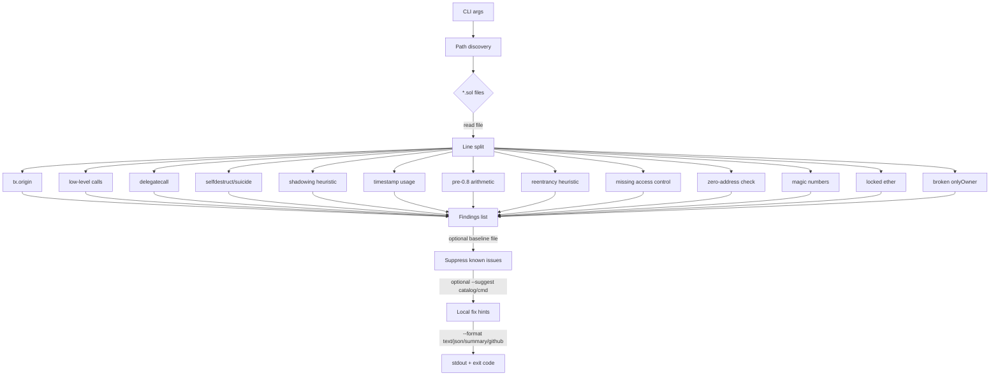

### sibaudit — fast Solidity heuristic scanner

Small, no-deps Python CLI that flags risky patterns in Solidity contracts — great for quick reviews and CI gates.

[](https://github.com/SibghatUllah1997/audit-agent-py/actions/workflows/ci.yml)
[](LICENSE)

Why it matters
- Solidity footguns still slip into production: low-level calls without checks, dangerous `delegatecall`, time manipulation, and pre-0.8 math overflows.
- sibaudit gives instant, readable feedback that complements deeper tools.

Rules

| Code | Severity | Flags |
|------|----------|-------|
| A001 | MEDIUM   | Risky use of `tx.origin` |
| A002 | MEDIUM   | Low-level call without capturing/validating success (heuristic) |
| A003 | HIGH     | Any `delegatecall` usage |
| A004 | HIGH     | `selfdestruct` / `suicide` |
| A005 | LOW      | Function parameter shadows a state variable (heuristic) |
| A006 | MEDIUM   | `block.timestamp` / `now` usage |
| A007 | MEDIUM   | Unchecked arithmetic in pre-0.8 Solidity |
| A008 | HIGH     | External call before a later state update (reentrancy heuristic) |
| A009 | HIGH     | Sensitive function that appears to lack access control |
| A010 | LOW      | Logic that relies on `tx.gasprice` |
| A011 | LOW      | `assert` used on caller input or balances (use `require`) |
| A012 | LOW      | Event missing a critical amount or address parameter |
| A013 | MEDIUM   | `blockhash` used as randomness or on the current block |
| A014 | HIGH     | `tx.origin` used in an authorization comparison |
| A015 | MEDIUM   | `address` variable declared without a value and never assigned |
| A016 | MEDIUM   | Address parameter stored without a zero-address check |
| A017 | LOW      | Numeric literal that is not a named constant |
| A018 | MEDIUM   | External call made inside a constructor |
| A019 | MEDIUM   | Payable function that can receive ether with no withdraw path |
| A020 | HIGH     | `onlyOwner`-style modifier that does not actually check the caller |

Install
- Python 3.11+
- Install editable or regular:

```bash
python3 -m pip install -e .
# or
python3 -m pip install sibaudit
```

Quick CLI demo
- Try the bundled vulnerable sample:

```bash
sibaudit examples/Vulnerable.sol
```

Example output (real):

```
/workspace/examples/Vulnerable.sol:13: A001 Potential risky use of tx.origin (often unsafe for auth).
/workspace/examples/Vulnerable.sol:17: A001 Potential risky use of tx.origin (often unsafe for auth).
/workspace/examples/Vulnerable.sol:20: A001 Potential risky use of tx.origin (often unsafe for auth).
/workspace/examples/Vulnerable.sol:20: A014 tx.origin used in an authorization comparison; prefer msg.sender.
/workspace/examples/Vulnerable.sol:12: A002 Low-level call without capturing/validating success (heuristic).
/workspace/examples/Vulnerable.sol:26: A002 Low-level call without capturing/validating success (heuristic).
/workspace/examples/Vulnerable.sol:26: A003 Use of delegatecall detected; review proxy pattern and calldata handling.
/workspace/examples/Vulnerable.sol:32: A004 Use of selfdestruct detected; can brick contracts and break integrations.
/workspace/examples/Vulnerable.sol:42: A005 Function parameter "owner" shadows a state variable.
/workspace/examples/Vulnerable.sol:38: A006 Use of block.timestamp/now detected; time can be manipulated slightly.
/workspace/examples/Vulnerable.sol:50: A007 Unchecked arithmetic in pre-0.8 Solidity (overflow/underflow risk).
/workspace/examples/Vulnerable.sol:92: A007 Unchecked arithmetic in pre-0.8 Solidity (overflow/underflow risk).
/workspace/examples/Vulnerable.sol:57: A008 External call before state update looks reentrancy-prone (heuristic).
/workspace/examples/Vulnerable.sol:24: A009 Sensitive function appears to lack access control (heuristic).
/workspace/examples/Vulnerable.sol:30: A009 Sensitive function appears to lack access control (heuristic).
/workspace/examples/Vulnerable.sol:42: A009 Sensitive function appears to lack access control (heuristic).
/workspace/examples/Vulnerable.sol:62: A009 Sensitive function appears to lack access control (heuristic).
/workspace/examples/Vulnerable.sol:68: A012 Event "Transfer" is missing a critical amount parameter.
/workspace/examples/Vulnerable.sol:78: A013 blockhash(block.number) is always zero and cannot seed randomness.
/workspace/examples/Vulnerable.sol:5: A015 State address "owner" is never assigned and stays address(0).
/workspace/examples/Vulnerable.sol:86: A016 Address parameter "newTreasury" is stored without a zero-address check.
/workspace/examples/Vulnerable.sol:92: A017 Magic numbers 25, 10000 are not named constants.
/workspace/examples/Vulnerable.sol:98: A018 External call via .call() inside a constructor; the contract is not fully set up.
/workspace/examples/Vulnerable.sol:107: A019 Payable receive() can receive ether, but the contract has no withdraw path.
/workspace/examples/Vulnerable.sol:109: A019 Payable function "donate" can receive ether, but the contract has no withdraw path.
/workspace/examples/Vulnerable.sol:119: A020 Modifier "onlyOwner" never checks the caller.
```

Notes
- Text output format is `path:line: CODE message`, followed by a counts summary.
- `--format summary` prints only the counts. `--format json` stays machine-readable (no summary footer).
- `--format github` prints GitHub Actions workflow commands so findings become inline annotations.
- `--suggest` adds a local fix hint under each finding (and a `suggestion` field in JSON).
- Exit code is 1 when findings exist, else 0.

Rule explanations
- `sibaudit --list-rules` prints every code with its severity and title.
- `sibaudit --explain A008` prints why the rule matters plus a flagged and a fixed snippet.
- The same text, for every rule, lives in [docs/RULES.md](docs/RULES.md). It is generated with
  `python -m sibaudit.rules > docs/RULES.md`, and tests scan each snippet so the examples stay honest.

Local fix hints

`--suggest` attaches a one-line fix hint to each finding from a built-in catalog. Nothing is sent over the network.

```bash
python3 -m sibaudit --suggest path/to/contracts
```

```
Token.sol:7: A001 Potential risky use of tx.origin (often unsafe for auth).
    hint: Prefer msg.sender for identity and authorization; tx.origin trusts every contract in the call chain.
```

- `--format json` adds a `suggestion` field and a `suggestion_source` (`catalog`, `command`, or `local-llm`). `--format github` appends the hint after an em dash. `--format summary` lists unique hints under each rule.
- `--suggest-catalog FILE` is a JSON object of `{ "A001": "your hint", ... }` and implies `--suggest`. Codes you omit keep the built-in text.
- `--suggest-cmd CMD` runs a local command once per finding. The finding is written as one JSON object on stdin (`file_path`, `line_number`, `code`, `severity`, `message`, `line_text`). The first non-empty stdout line becomes the hint. If the command fails, times out, or prints nothing, the catalog hint is used instead.
- `--suggest-backend local-llm --llm-model NAME` asks a model served on this machine through an Ollama-compatible `/api/generate` endpoint (default `http://127.0.0.1:11434`, change with `--llm-url`). Only loopback URLs are accepted, so source code never leaves the machine. If the model is down or replies with nothing useful, that finding gets the catalog hint and a note is printed to stderr.
- Suggestions are hints for a human reviewer, not patches; nothing is rewritten.
- A sample catalog and a sample command live in `examples/suggest/`.

JSON output

You can emit newline-delimited JSON records instead of text:

```bash
python3 -m sibaudit --format json path/to/contracts > findings.ndjson
```

Each line is a JSON object with:

- `file_path` (string)
- `line_number` (int)
- `code` (string, e.g. `A001`)
- `severity` (string: `LOW` | `MEDIUM` | `HIGH`)
- `message` (string)
- `suggestion` (string, only when `--suggest` is on)
- `suggestion_source` (string: `catalog` | `command` | `local-llm`, only when `--suggest` is on)

Include and exclude files

Use `--include` and `--exclude` (both repeatable) to pick which `.sol` files are scanned:

```bash
python3 -m sibaudit contracts --include 'src/*' --exclude 'Mock*.sol' --exclude 'lib/*'
```

- Globs match the path relative to the scanned folder, or any trailing part of it.
  `Mock*.sol` matches `src/test/MockToken.sol`; `lib/*` matches `lib/dep/Dep.sol`.
- `*` also matches `/`. A leading `**/` is optional.
- With no `--include`, every file is included. `--exclude` always wins.
- A file passed directly is matched by its name only.

Baseline suppression

Snapshot today's findings, then hide them on later scans so only new issues show up:

```bash
python3 -m sibaudit path/to/contracts --write-baseline .sibaudit-baseline.json
python3 -m sibaudit path/to/contracts --baseline .sibaudit-baseline.json
```

- The file is JSON: `version` plus a `findings` list of `{file, line, code}`.
- Paths are stored relative to the current working directory.
- `--write-baseline` records the full current scan, even when `--baseline` is also set.
- A missing or invalid baseline file exits with code 2.

Summary report

Text output ends with counts per rule and per severity. Use `--format summary` for the counts alone:

```bash
python3 -m sibaudit path/to/contracts --format summary
```

```
3 findings

by rule
  A001  MEDIUM  2
  A003  HIGH    1

by severity
  HIGH    1
  MEDIUM  2
```

Use it in VS Code

`examples/vscode/tasks.json` has ready-made tasks. Copy it to `.vscode/tasks.json` in your project (or merge the entries into an existing file):

- `sibaudit: scan workspace (text)` and `sibaudit: scan current file (text)` run the scanner and turn each finding into an entry in the Problems panel.
- `sibaudit: scan workspace (json)` prints newline-delimited JSON in the terminal, with no editor diagnostics.

Run one with "Tasks: Run Task" from the command palette. The text tasks use this problem matcher regex, which fits the `path:line: CODE message` output:

```
^(.+?):(\d+): (A\d{3}) (.+)$
```

- The counts summary at the end of the text output does not match, so it never shows up as a problem.
- Findings appear as warnings. The CLI exits with 1 when it finds something, so the task is marked as failed; that is expected.
- A test runs the real CLI and checks the example regex against its output, so the docs and the format stay in sync.
- The tasks call `python3 -m sibaudit`, so install the package in the interpreter VS Code uses.

Use it with pre-commit

This repository ships a `.pre-commit-hooks.yaml`, so any Solidity project can run sibaudit on staged `.sol` files before each commit. Add this to `.pre-commit-config.yaml` (a fuller sample is in `examples/pre-commit/.pre-commit-config.yaml`):

```yaml
repos:
  - repo: https://github.com/SibghatUllah1997/audit-agent-py
    rev: <commit-sha>
    hooks:
      - id: sibaudit
        # args: [--baseline, .sibaudit-baseline.json]
```

```bash
pip install pre-commit
pre-commit install
pre-commit run --all-files
```

- The hook only runs on files `pre-commit` tags as Solidity, and only on the files in the commit.
- Any finding makes the hook fail and blocks the commit. Use `--baseline` to accept findings you have already triaged, or `// sibaudit:ignore-next-line` for a single line.
- Pin `rev` to a commit SHA. A branch name works but `pre-commit` warns that it is mutable.
- Already installed sibaudit? The sample also shows a `repo: local` hook with `language: system`.

GitHub annotations

`--format github` prints one workflow command per finding. HIGH maps to `error`, MEDIUM to `warning`, and LOW to `notice`. Paths are workspace-relative when possible. There is no counts footer.

```bash
python3 -m sibaudit --format github path/to/contracts
```

```
::warning file=Token.sol,line=7,title=A001 (MEDIUM)::Potential risky use of tx.origin (often unsafe for auth).
```

Use it as a GitHub Action

`examples/github/annotate.yml` is a ready-made workflow. Copy it to `.github/workflows/sibaudit.yml` in a Solidity project:

- It installs `sibaudit`, scans `.` with `--format github`, and fails the job when findings exist.
- Annotations still show on the pull request when the step fails.
- Change the scan path if contracts do not live at the repo root.

Ignoring one line

Add the following directive on a line to ignore the very next line (for all rules):

```solidity
// sibaudit:ignore-next-line
address a = tx.origin; // this line will be ignored
```

Testing
- Lint with ruff; tests use pytest.
- Run:

```bash
python3 -m ruff check .
python3 -m pytest -q
```

Architecture (sketch)



Roadmap
- See `ROADMAP.md`.

What this is (and isn't)
- An educational heuristic scanner, not a full static analyzer.
- Rules are intentionally simple pattern checks, so expect false positives and misses.
- Always verify results manually, and use professional tools and reviews for real security work.

License

MIT © 2026 HM Sibghat Ullah
