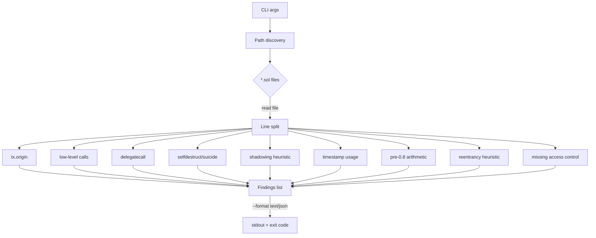

### sibaudit — fast Solidity heuristic scanner

Small, no-deps Python CLI that flags risky patterns in Solidity contracts — great for quick reviews and CI gates.

[](https://github.com/SibghatUllah1997/audit-agent-py/actions/workflows/ci.yml)
[](LICENSE)

Why it matters
- Solidity footguns still slip into production: low-level calls without checks, dangerous `delegatecall`, time manipulation, and pre-0.8 math overflows.
- sibaudit gives instant, readable feedback that complements deeper tools.

Rules

| Code | Severity | Flags |
|------|----------|-------|
| A001 | MEDIUM   | Risky use of `tx.origin` |
| A002 | MEDIUM   | Low-level call without capturing/validating success (heuristic) |
| A003 | HIGH     | Any `delegatecall` usage |
| A004 | HIGH     | `selfdestruct` / `suicide` |
| A005 | LOW      | Function parameter shadows a state variable (heuristic) |
| A006 | MEDIUM   | `block.timestamp` / `now` usage |
| A007 | MEDIUM   | Unchecked arithmetic in pre-0.8 Solidity |
| A008 | HIGH     | External call before a later state update (reentrancy heuristic) |
| A009 | HIGH     | Sensitive function that appears to lack access control |
| A010 | LOW      | Logic that relies on `tx.gasprice` |
| A011 | LOW      | `assert` used on caller input or balances (use `require`) |
| A012 | LOW      | Event missing a critical amount or address parameter |
| A013 | MEDIUM   | `blockhash` used as randomness or on the current block |

Install
- Python 3.11+
- Install editable or regular:

```bash
python3 -m pip install -e .
# or
python3 -m pip install sibaudit
```

Quick CLI demo
- Try the bundled vulnerable sample:

```bash
sibaudit examples/Vulnerable.sol
```

Example output (real):

```
/workspace/examples/Vulnerable.sol:13: A001 Potential risky use of tx.origin (often unsafe for auth).
/workspace/examples/Vulnerable.sol:12: A002 Low-level call without capturing/validating success (heuristic).
/workspace/examples/Vulnerable.sol:20: A002 Low-level call without capturing/validating success (heuristic).
/workspace/examples/Vulnerable.sol:20: A003 Use of delegatecall detected; review proxy pattern and calldata handling.
/workspace/examples/Vulnerable.sol:26: A004 Use of selfdestruct detected; can brick contracts and break integrations.
/workspace/examples/Vulnerable.sol:18: A005 Function parameter "data" shadows a state variable.
/workspace/examples/Vulnerable.sol:24: A005 Function parameter "to" shadows a state variable.
/workspace/examples/Vulnerable.sol:36: A005 Function parameter "owner" shadows a state variable.
/workspace/examples/Vulnerable.sol:56: A005 Function parameter "qty" shadows a state variable.
/workspace/examples/Vulnerable.sol:32: A006 Use of block.timestamp/now detected; time can be manipulated slightly.
/workspace/examples/Vulnerable.sol:44: A007 Unchecked arithmetic in pre-0.8 Solidity (overflow/underflow risk).
/workspace/examples/Vulnerable.sol:51: A008 External call before state update looks reentrancy-prone (heuristic).
/workspace/examples/Vulnerable.sol:18: A009 Sensitive function appears to lack access control (heuristic).
/workspace/examples/Vulnerable.sol:24: A009 Sensitive function appears to lack access control (heuristic).
/workspace/examples/Vulnerable.sol:36: A009 Sensitive function appears to lack access control (heuristic).
/workspace/examples/Vulnerable.sol:56: A009 Sensitive function appears to lack access control (heuristic).
```

Notes
- Text output format is `path:line: CODE message`. Exit code is 1 when findings exist, else 0.

JSON output

You can emit newline-delimited JSON records instead of text:

```bash
python3 -m sibaudit --format json path/to/contracts > findings.ndjson
```

Each line is a JSON object with:

- `file_path` (string)
- `line_number` (int)
- `code` (string, e.g. `A001`)
- `severity` (string: `LOW` | `MEDIUM` | `HIGH`)
- `message` (string)

Include and exclude files

Use `--include` and `--exclude` (both repeatable) to pick which `.sol` files are scanned:

```bash
python3 -m sibaudit contracts --include 'src/*' --exclude 'Mock*.sol' --exclude 'lib/*'
```

- Globs match the path relative to the scanned folder, or any trailing part of it.
  `Mock*.sol` matches `src/test/MockToken.sol`; `lib/*` matches `lib/dep/Dep.sol`.
- `*` also matches `/`. A leading `**/` is optional.
- With no `--include`, every file is included. `--exclude` always wins.
- A file passed directly is matched by its name only.

Ignoring one line

Add the following directive on a line to ignore the very next line (for all rules):

```solidity
// sibaudit:ignore-next-line
address a = tx.origin; // this line will be ignored
```

Testing
- Lint with ruff; tests use pytest.
- Run:

```bash
python3 -m ruff check .
python3 -m pytest -q
```

Architecture (sketch)



Roadmap
- See `ROADMAP.md`.

License

MIT © 2026 HM Sibghat Ullah
# Sibghat's Solidity Audit Helper

A tiny, educational Python CLI that scans Solidity (`.sol`) files for a few well-known risky patterns:

- Use of `tx.origin` (often misused for authentication)
- Unchecked low-level calls (e.g., `address.call(...)`) where the success value is not obviously verified
- Use of `delegatecall`
- Use of `selfdestruct` / `suicide`
- Use of `block.timestamp` / `now`
- Unchecked arithmetic in pre-0.8 Solidity
- External calls that happen before a later storage write (reentrancy-prone)
- Privileged functions that appear to lack access control

This is an intentionally minimal, static checker to bootstrap a daily portfolio project.

## Quickstart

1) Ensure Python 3.11+
2) Install in editable mode:

```bash
python3 -m pip install -e .
```

3) Run against a file or directory:

```bash
sibaudit path/to/contracts
# or
python3 -m sibaudit path/to/contracts
```

Findings are printed in `path:line: CODE message` format. The CLI exits with code 1 if any findings are detected, otherwise 0.

### JSON output

You can emit newline-delimited JSON records instead of text:

```bash
python3 -m sibaudit --format json path/to/contracts > findings.ndjson
```

Each line is a JSON object with:

- `file_path` (string)
- `line_number` (int)
- `code` (string, e.g. `A001`)
- `severity` (string: `LOW` | `MEDIUM` | `HIGH`)
- `message` (string)

### Ignoring one line

Add the following directive on a line to ignore the very next line (for all rules):

```solidity
// sibaudit:ignore-next-line
address a = tx.origin; // this line will be ignored
```

## Severities and rule codes

- A001 (MEDIUM): Potential risky use of `tx.origin`
- A002 (MEDIUM): Low-level call without capturing/validating success (heuristic)
- A003 (HIGH): Use of `delegatecall` detected (dangerous; review proxy usage carefully)
- A004 (HIGH): Use of `selfdestruct`/`suicide` detected (can brick contracts)
- A005 (LOW): State variable shadowing by a parameter or local variable (heuristic)
- A006 (MEDIUM): Use of `block.timestamp` / `now` (time can be manipulated slightly)
- A007 (MEDIUM): Unchecked arithmetic in pre-0.8 Solidity (overflow/underflow risk)
- A008 (HIGH): External call before a later state update (reentrancy heuristic)
- A009 (HIGH): Sensitive function that appears to lack access control (heuristic)
- A010 (LOW): Logic relies on `tx.gasprice`, which the sender controls
- A011 (LOW): `assert` checks caller input or balances; prefer `require`
- A012 (LOW): Event missing a critical amount or address parameter
- A013 (MEDIUM): `blockhash` is miner-influenceable; current-block hash is always zero

## What this is (and isn’t)

- This is an educational toy, not a full static analyzer.
- Rules are intentionally naive heuristics to keep things approachable.
- You should always verify results manually and consult professional tools and reviews for any real security work.

## License

MIT — Copyright (c) 2026 HM Sibghat Ullah

